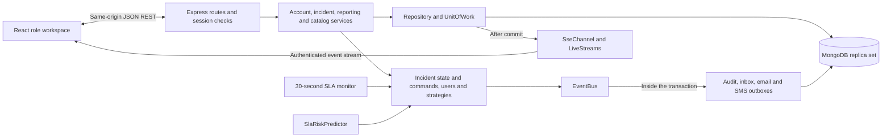

# Architecture

Nexora is a layered React, Express and MongoDB application. The browser renders the role workspace and sends JSON requests on the same origin. Express resolves the session, validates the request and invokes a business operation. The domain class and configured strategies determine what happens. Repositories pass MongoDB operations through the current unit of work.

The report operation checks role and inputs, finds related reports, classifies, computes priority, creates SLA deadlines and assigns an eligible technician. The incident and its audit and notification rows commit together. The HTTP response returns its ID. Repeat submissions from the same reporter with the same request ID return the same incident.

Workflow commands save with an expected incident version. Administrative unassignment, technician decline, cancellation and resolution release technician load. Assignment conditionally increments the selected technician's load and follows the configured strategy. Separate counters allocate IDs without holding the transaction on a global settings row. Sequence gaps can occur during retries.

The browser opens one `GET /api/events` stream for its signed-in workspace. Live messages are small invalidations or recipient-only notification summaries. The browser fetches authoritative data through normal REST endpoints. The stream retries every five seconds. Reads use a 60-second polling fallback for connected event-driven views and a 10-second fallback while disconnected.

Deployment is a single API process with a replica-set MongoDB, locally installed or started through Docker Compose. The connection registry lives in that API process. MongoDB change streams or an external message broker would carry committed events across multiple processes. See [Security](security.md), [Database](er-diagram.md) and [Class diagrams](class-diagram.md).
