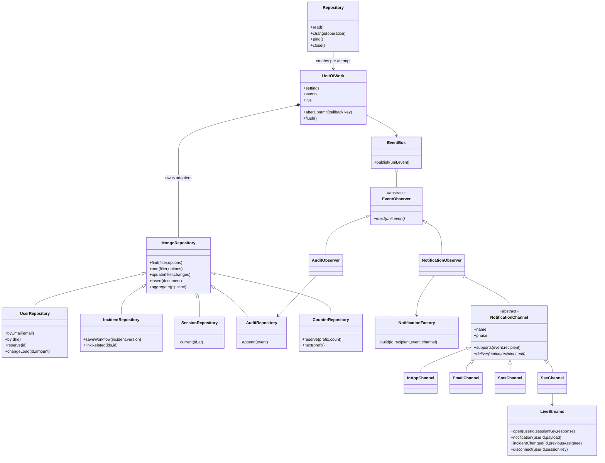

# Class diagrams

## Domain and workflow

```mermaid
classDiagram
  class User {
    +id
    +name
    +email
    +role
    +incidentScope()
    +canSee(incident)
    +publicProfile()
    +toDocument()
  }
  class Employee {
    +details(input)$
  }
  class Technician {
    +details(input)$
    +incidentScope()
    +canSee(incident)
  }
  class Administrator {
    +details(input)$
    +incidentScope()
    +canSee(incident)
  }
  class UserFactory {
    +create(role,input)$
    +from(document)$
  }
  class Incident {
    +id
    +status
    +version
    +sla
    +transition(status,at)
    +assign(technician,at)
    +resolve(text,author,at)
    +reopen(text,author,at)
    +cancel(text,author,at)
    +snapshot()
  }
  class IncidentState {
    +name
    +open
    +next
    +canGoTo(target)
  }
  class NewState
  class ClassifiedState
  class AssignedState
  class AcknowledgedState
  class InProgressState
  class PendingInfoState
  class ResolvedState
  class VerifiedState
  class ClosedState
  class CancelledState
  class IncidentAction {
    <<abstract>>
    +execute(context,input)*
  }
  class AssignAction
  class ChangePriorityAction
  class AcknowledgeAction
  class InvestigateAction
  class AddNoteAction
  class RequestInfoAction
  class ReplyAction
  class ResolveAction
  class VerifyAction
  class CloseAction
  class CancelAction
  class DeclineAction
  class UnassignAction
  class AssignmentStrategy {
    <<abstract>>
    +rank(teams,incident)
    +score(technician,incident,context)*
  }
  class SkillBased
  class LoadBased
  class ExperienceBased
  class RoundRobin
  class PriorityStrategy {
    <<abstract>>
    +evaluate(incident)*
  }
  class WeightedPriority
  class RulePriority
  class SlaRiskPredictor {
    +predict(incident,context)
  }
  User <|-- Employee
  User <|-- Technician
  User <|-- Administrator
  UserFactory ..> User
  Incident --> "1" IncidentState : current state
  IncidentState <|-- NewState
  IncidentState <|-- ClassifiedState
  IncidentState <|-- AssignedState
  IncidentState <|-- AcknowledgedState
  IncidentState <|-- InProgressState
  IncidentState <|-- PendingInfoState
  IncidentState <|-- ResolvedState
  IncidentState <|-- VerifiedState
  IncidentState <|-- ClosedState
  IncidentState <|-- CancelledState
  IncidentAction ..> Incident : updates
  IncidentAction <|-- AssignAction
  IncidentAction <|-- ChangePriorityAction
  IncidentAction <|-- AcknowledgeAction
  IncidentAction <|-- InvestigateAction
  IncidentAction <|-- AddNoteAction
  IncidentAction <|-- RequestInfoAction
  IncidentAction <|-- ReplyAction
  IncidentAction <|-- ResolveAction
  IncidentAction <|-- VerifyAction
  IncidentAction <|-- CloseAction
  IncidentAction <|-- CancelAction
  IncidentAction <|-- DeclineAction
  IncidentAction <|-- UnassignAction
  AssignmentStrategy <|-- SkillBased
  AssignmentStrategy <|-- LoadBased
  AssignmentStrategy <|-- ExperienceBased
  AssignmentStrategy <|-- RoundRobin
  PriorityStrategy <|-- WeightedPriority
  PriorityStrategy <|-- RulePriority
  SlaRiskPredictor ..> Incident : forecasts
```

State instances are shared and immutable. Each incident holds its current state and persists its name. A command checks the actor and delegates valid transitions to the aggregate. Strategy registries select implementation objects by the stored keys. Round robin overrides ranking because its ordering depends on the last assignment.

## Events and persistence

`EventBus.publish` calls each observer. The audit observer appends history, and the notification observer selects recipients and invokes the channel adapters through their common contract. The unit of work keeps a new callback queue for every transaction attempt and dispatches live notices only from the successful attempt. The persistent channels use the active MongoDB session.

Sources [domain classes](../server/domain/), [event bus](../server/events.js), [notification channels](../server/notifications/), [repository](../server/database.js), [collection repositories](../server/repositories.js).
