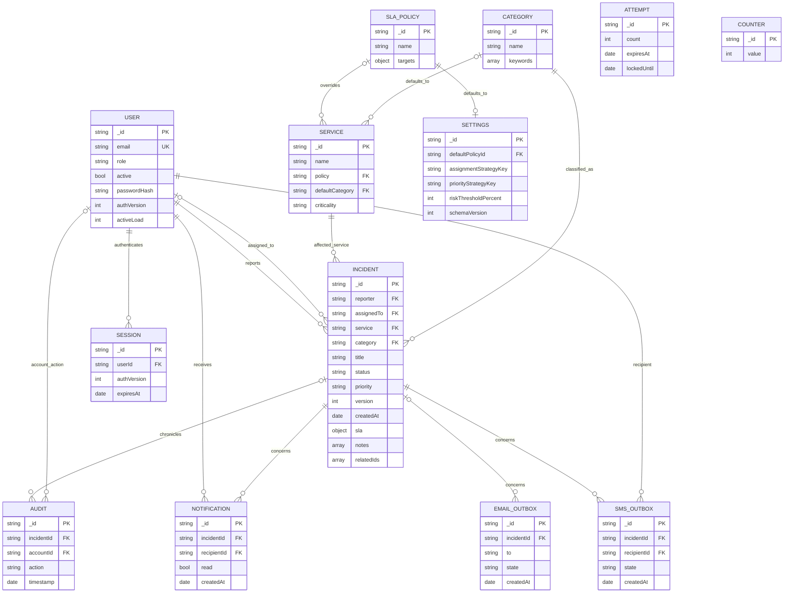

# MongoDB schema

The diagram describes logical references. Incident SLA, notes and feedback are embedded. Application code and transactions maintain references between collections.



| Collection                           | Details                                                                                                                                                                                                                                                       |
| ------------------------------------ | ------------------------------------------------------------------------------------------------------------------------------------------------------------------------------------------------------------------------------------------------------------- |
| `users`                              | Employees store department and location. Technician fields include skills, experience, team lead, availability, maximum capacity and current open load. Administrators have a title.                                                                          |
| `incidents`                          | Stores metadata, lifecycle version, references and a reporter-scoped request ID. The embedded SLA records targets, timestamps, findings, pause duration and `riskNotified`. Related IDs are bidirectional. `sampleTag` identifies optional synthetic history. |
| `services`, `categories`, `policies` | Service catalogue, classification keywords and per-priority SLA targets.                                                                                                                                                                                      |
| `audit`, `notifications`             | Append-only operation history and per-user in-app messages with read state. Account audit entries have `accountId` and a null incident ID.                                                                                                                    |
| `emailOutbox`, `smsOutbox`           | Simulated deliveries. Older email rows may only have the destination address.                                                                                                                                                                                 |
| `settings`, `counters`               | The `global` document stores configuration. Per-prefix counters allocate IDs independently.                                                                                                                                                                   |
| `sessions`, `attempts`               | Expiring sessions and login quotas. The stored session identifier is a digest.                                                                                                                                                                                |

Unique indexes cover user email, the incident reporter/request ID pair and synthetic history tags where present. Additional indexes support the reporter, assignee, service and priority queries, closed-history selection, audit history, recipients and outbox ordering. Sessions and attempt counters have TTL indexes. See the index definitions in [database.js](../server/database.js).

Selected fields from the bundled seed:

```json
{
  "_id": "SVC1",
  "name": "Payment Gateway",
  "criticality": "CRITICAL",
  "policy": "SLA1",
  "defaultCategory": "Application"
}
```

```json
{ "_id": "SLA1", "name": "Gold", "targets": { "P1": { "responseMinutes": 5, "resolutionMinutes": 30 } } }
```

The demo imports 11 users, 11 incidents, 8 services, 9 categories, 2 policies, 87 audit rows, 108 in-app notifications and 96 simulated emails. The upgrade from schema 1 preserves records, reconstructs active technician loads, and initializes pauses on existing pending-information cases. [Original demo snapshot](../server/seed/snapshot.json)
