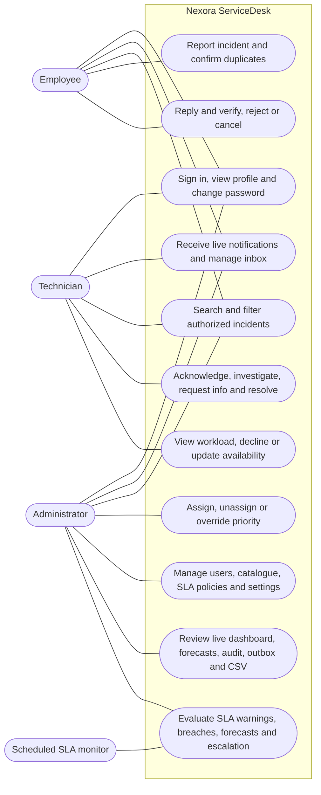
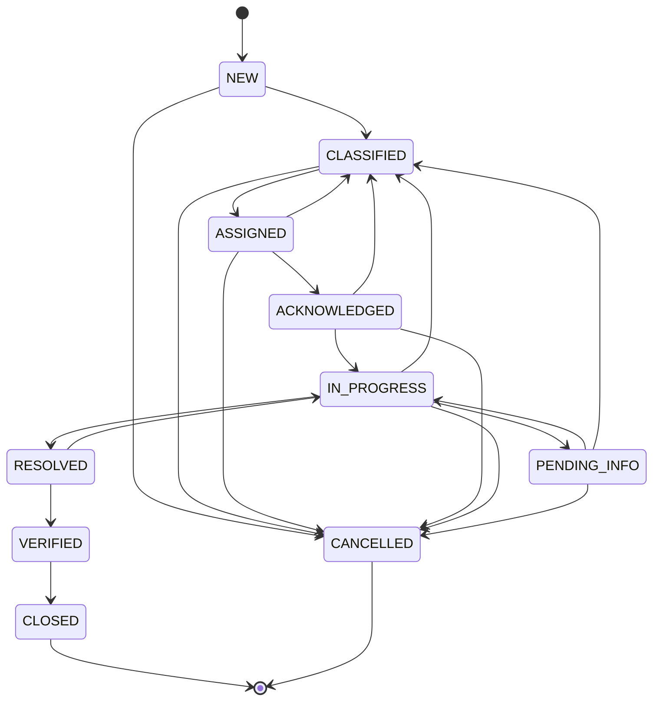

# Use cases

Employees work on reports they submitted. The technician queue shows assignments. Technicians can read assigned incidents and incidents they reported. Administrators can inspect all incidents. The server validates the role and ownership again for every operation.

In pending information, the resolution clock is paused. Replying, resuming investigation or clearing the assignment resumes it. A completed response clock retains its deadline and acknowledgement.
